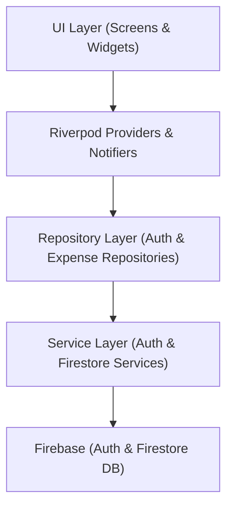

# Spendly 💳
> **Track your spending. Understand your money.**

Spendly is a modern, production-style personal expense tracker mobile application built with **Flutter**, **Firebase Authentication**, **Cloud Firestore**, and **Riverpod** for the CyphLab Flutter Developer Internship Practical Selection Task.

---

## 📱 Features

- 🔐 **Firebase Authentication**: Secure user login and registration with validation, password toggle, and error handling.
- ➕ **Add Expense**: Create expenses with title, amount, category, date picker, and optional note.
- ✏️ **Edit Expense**: Pre-filled expense forms for smooth updates without duplicating entries.
- 🗑️ **Delete Expense**: Delete expense with a confirmation dialog and dynamic total recalculations.
- 🏷️ **Expense Categories**: 9 predefined categories (*Food, Transport, Shopping, Bills, Health, Education, Entertainment, Travel, Other*) with dedicated colors and icons.
- 📊 **Dynamic Dashboard**: Calculates current month total, transaction count, average transaction amount, and recent expenses.
- 🔎 **Search & Filter**: Search by title, note, or category name in real time. Filter by categories or date ranges.
- 📈 **Visual Analytics**: Interactive doughnut spending distribution chart using `fl_chart`.
- 🌙 **Dark Mode Support**: Material 3 Light and Dark themes with persistent user preferences saved via `shared_preferences`.
- 🚀 **Interactive Onboarding Walkthrough**: 3-step interactive onboarding slider highlighting core benefits with persistent completion tracking and replay option in Settings.
- ✨ **Animated Brand Splash Screen**: Smooth entry animations with seamless transition to authentication or dashboard.
- 🎨 **Custom App Launcher Icons**: Handcrafted modern adaptive icons across Android, iOS, macOS, Web, and Windows.
- 🔒 **User Data Security**: Strict user-level Firestore data isolation (`users/{userId}/expenses/{expenseId}`) enforced with Firestore Security Rules.
- ⚡ **Offline-Ready & Real-Time**: Stream-based updates via Cloud Firestore for instant sync.

---

## 🛠️ Tech Stack

- **Framework**: [Flutter](https://flutter.dev) (Dart 3)
- **State Management**: [Riverpod 3](https://riverpod.dev) (`Notifier` & `StreamProvider`)
- **Backend & Database**: [Firebase Auth](https://firebase.google.com/docs/auth) & [Cloud Firestore](https://firebase.google.com/docs/firestore)
- **UI Design System**: Material 3 Design
- **Charts & Visualization**: [fl_chart](https://pub.dev/packages/fl_chart)
- **Date & Number Formatting**: [intl](https://pub.dev/packages/intl)
- **Local Persistence**: [shared_preferences](https://pub.dev/packages/shared_preferences)

---

## 🏛️ Project Architecture

Spendly uses a clean, layered architecture designed for maintainability and testability without enterprise over-engineering:



### Key Architectural Decisions:
1. **Riverpod State Management**: Decouples business logic from UI widgets. Derived providers (`selectedMonthTotalProvider`, `filteredExpensesProvider`) automatically recompute values efficiently without redundant database queries.
2. **Repository & Service Pattern**: Abstracts Firebase SDK calls behind repository interfaces, making business logic easy to mock and unit test.
3. **Data Model Immutability**: `Expense` and `AppUser` models provide `fromFirestore`, `toFirestore`, and `copyWith` methods ensuring type safety across all layers.

---

## 📁 Project Structure

```text
lib/
├── core/
│   ├── constants/       # Color palette, spacing, and category definitions
│   ├── errors/          # Custom AppException for user-friendly errors
│   ├── theme/           # Material 3 light and dark theme configurations
│   ├── utils/           # Currency (Rs.) and Date formatters
│   └── validators/      # Form input validation rules
├── models/              # Expense, Category, and AppUser data models
├── services/            # Direct Firebase Auth & Firestore API callers
├── repositories/        # Repository interfaces & concrete implementations
├── providers/           # Riverpod state notifiers and stream providers
├── screens/
│   ├── auth/            # Login & Register screens
│   ├── home/            # Dashboard overview screen
│   ├── expenses/        # History list, Add & Edit expense screens
│   ├── analytics/       # Spending analytics & doughnut chart screen
│   └── settings/        # Theme switcher, profile info & logout screen
├── widgets/             # Reusable cards, empty states, charts & forms
├── firebase_options.dart # Default Firebase configuration
└── main.dart            # App entry point & AuthGate
```

---

## 🔒 Security & Firestore Rules

User data is completely isolated using strict security rules located in [`firestore.rules`](./firestore.rules):

```javascript
rules_version = '2';
service cloud.firestore {
  match /databases/{database}/documents {
    match /users/{userId} {
      allow read, write: if request.auth != null && request.auth.uid == userId;

      match /expenses/{expenseId} {
        allow read, write: if request.auth != null && request.auth.uid == userId;
      }
    }
  }
}
```

---

## 🚀 Getting Started & Setup

### Prerequisites
- Flutter SDK (`>=3.44.0`)
- Dart SDK (`>=3.12.0`)
- A Firebase project with **Email/Password Auth** and **Cloud Firestore** enabled.

### Installation

1. **Clone the repository**:
   ```bash
   git clone https://github.com/Kavi20021026/spendly-expense-tracker.git
   cd spendly-expense-tracker
   ```

2. **Install dependencies**:
   ```bash
   flutter pub get
   ```

3. **Configure Firebase**:
   Configure FlutterFire for your platform:
   ```bash
   flutterfire configure
   ```

4. **Run the application**:
   ```bash
   flutter run
   ```

5. **Build Release APK**:
   ```bash
   flutter build apk --release
   ```
   The generated APK will be located in `build/app/outputs/flutter-apk/app-release.apk`.

---

## 🧪 Testing

Run unit and widget tests:
```bash
flutter test
```

---

## 🤖 AI-Assisted Development Statement

In accordance with internship guidelines:
- **Tools Used**: AI Coding Assistant (Antigravity with Gemini 3.6 Flash).
- **Assistance Areas**: Initial architecture planning, boilerplate generation, form validation regex, and draft documentation.
- **Review & Verification**: All generated code was thoroughly reviewed, refactored to conform strictly to Flutter/Riverpod best practices, validated against compilation errors, and verified with automated unit and widget tests.

---

## 🔮 Future Improvements

- 📌 **Budget Limits**: Set monthly category spending caps with warning alerts.
- 🔄 **Recurring Expenses**: Support scheduled subscription & bill payments.
- 📄 **Export Reports**: Generate PDF/CSV expense statements.
- 🧾 **Receipt Scanning**: OCR receipt image parsing.

---

## 📜 License

Distributed under the MIT License. See `LICENSE` for more information.

---

## 👤 Author

Developed by **Kavindu Dissanayaka** for the **CyphLab Flutter Developer Internship Selection Process**.
